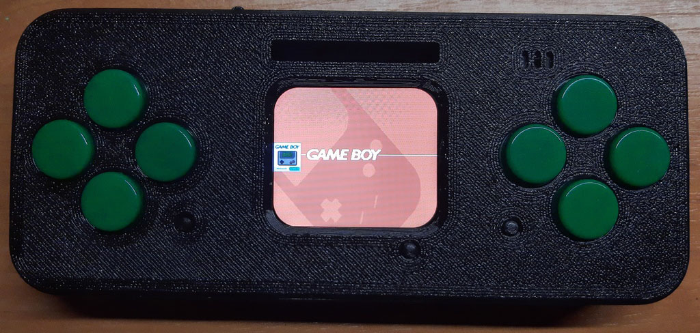

# Lilka
- Ref: https://github.com/lilka-dev

This port developed for the Lilka, based on the ESP32-S3 microcontroller.

# Hardware info

- Espressif ESP32-S3-WROOM-1-N16R8 (16MB flash + 8MB PSRAM)
- ST7789-based 1.69-inch IPS LCD (280x240)
- SPI microSD card reader
- 10 input + 1 reset buttons
- MAX98357 DAC with 1W speaker

# Buttons

| Lilka             | Retro Go      | GPIO |
| ----------------- | ------------- | ---- |
| LILKA_GPIO_UP     | RG_KEY_UP     | 38   |
| LILKA_GPIO_DOWN   | RG_KEY_DOWN   | 41   |
| LILKA_GPIO_LEFT   | RG_KEY_LEFT   | 39   |
| LILKA_GPIO_RIGHT  | RG_KEY_RIGHT  | 40   |
| LILKA_GPIO_START  | RG_KEY_START  | 4    |
| LILKA_GPIO_C      | RG_KEY_OPTION | 10   |
| LILKA_GPIO_D      | RG_KEY_MENU   | 9    |
| LILKA_GPIO_A      | RG_KEY_A      | 5    |
| LILKA_GPIO_B      | RG_KEY_B      | 6    |
| LILKA_GPIO_SELECT | RG_KEY_SELECT | 0    |

# Images

